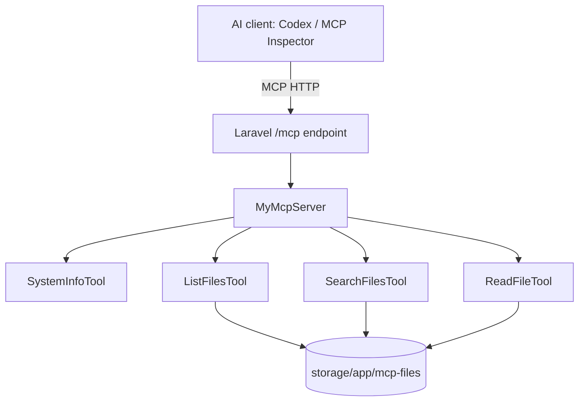

# Laravel MCP File Server

**A simple, read-only Model Context Protocol server built with Laravel 13.**

Use any compatible MCP client to discover files, search by filename, read text files, and inspect basic application version information. Designed as a **local developer example** with clear boundaries and easy-to-extend Laravel classes.

> **Project status: alpha release candidate.** Application source and automated MCP tests are included. See [verification results](docs/RELEASE_VERIFICATION.md) for executed checks and remaining publication blockers.
> **Security:** This version is for trusted local development **only**. The HTTP endpoint does not yet have authentication. **Do not expose it to the public internet or a shared network.**

## At a glance

| | |
| --- | --- |
| Framework | Laravel 13 |
| PHP | 8.4+ for locked development dependencies (tested on 8.5.10) |
| MCP package | `laravel/mcp` (locally tested with 1.1.1) |
| Transport | Streamable HTTP on loopback |
| Tools | `SystemInfoTool`, `ListFilesTool`, `ReadFileTool`, `SearchFilesTool` |
| Allowed files | Non-recursive files inside `storage/app/mcp-files` |
| Writes | No MCP file-writing tools in this version |
| Tested clients | MCP Inspector and OpenAI Codex |

## Screenshots — real working examples

**1. The MCP Inspector successfully connects to Laravel over Streamable HTTP:**


**2. Inspector discovers all four tools and displays a successful System Info result:**


**3. The Search Files tool exposes its required query input:**


These are genuine screenshots of the working local server. The third image shows the search **form**, not the result of a completed search. [View more screenshots](docs/SCREENSHOTS.md), including PhpStorm connection and Codex tool approval. A completed `ReadFileTool` call captured in the Inspector is still recommended before release. Never publish authentication tokens or other secrets.

## Architecture



## Quick start

Requirements: **PHP 8.4+**, Composer, a locally running Laravel 13 project with `laravel/mcp`, and Node.js/npm only if using MCP Inspector. The example below assumes you've cloned this **complete Laravel application** from its eventual GitHub repository. Replace `YOUR_USERNAME` after publication.

```powershell
# Windows PowerShell
git clone https://github.com/YOUR_USERNAME/laravel-mcp-file-server.git
cd laravel-mcp-file-server
composer install
Copy-Item .env.example .env
php artisan key:generate
New-Item -ItemType Directory -Force storage\app\mcp-files
Set-Content storage\app\mcp-files\example.txt 'Hello from my Laravel MCP server!'
php artisan serve --host=127.0.0.1 --port=8123
```

On Linux/macOS, replace `Copy-Item` with `cp`, `New-Item` with `mkdir -p`, and `Set-Content` with `printf 'Hello from my Laravel MCP server!\n' > storage/app/mcp-files/example.txt`.

In `.env`, use `APP_URL=http://127.0.0.1:8123` and keep `APP_DEBUG=false` only for local development. Do not start the server on `0.0.0.0`.

Check the route from another terminal:

```powershell
php artisan route:list --path=mcp
curl.exe -i http://127.0.0.1:8123/mcp
```

**A `405 Method Not Allowed` on a normal GET request is expected.** MCP clients communicate using the protocol; visiting `/mcp` in a normal browser does not render a website. A `404` often means you're connecting to a different Laravel project or the wrong port.

See [detailed installation](docs/INSTALLATION.md).

## Connect OpenAI Codex

With Codex CLI installed and authenticated:

```powershell
codex mcp add laravel-files --url http://127.0.0.1:8123/mcp
codex mcp list
codex
```

Ask Codex:

> Use the `laravel-files` MCP server to list the files, search for `example.txt`, and read it. Show which MCP tools were called. Do not modify any files.

The expected content is `Hello from my Laravel MCP server!` if you created the demonstration file. Approve the individual MCP calls when prompted. See [client setup and troubleshooting](docs/CLIENTS.md).

## Test with MCP Inspector

```powershell
php artisan mcp:inspector mcp
```

When launched, Inspector should point to `http://127.0.0.1:8123/mcp` if your Laravel `.env` has the right `APP_URL`. Click **Connect → Tools → List Tools**, then run the file tools.

If other Inspectors occupy ports 6274/6275, consult [troubleshooting](docs/CLIENTS.md) rather than terminating unrelated Node.js processes.

## Tool reference

| Tool | Arguments | Returns |
| --- | --- | --- |
| `SystemInfoTool` | None | PHP and Laravel version details |
| `ListFilesTool` | None | Filenames and byte sizes |
| `ReadFileTool` | `filename` (string) | Text file contents; UTF-8 text, up to 1 MiB |
| `SearchFilesTool` | `query` (string) | Filenames containing the query (case-insensitive) |

The filename-based tools are non-recursive, and the read tool only accepts a simple filename with one of `.txt`, `.md`, `.json`, `.csv`, or `.log`. See [tool specification](docs/TOOLS.md) for exact behavior, limits and errors.

## Project layout

```text
app/Mcp/
  Servers/MyMcpServer.php
  Tools/SystemInfoTool.php
  Tools/ListFilesTool.php
  Tools/ReadFileTool.php
  Tools/SearchFilesTool.php
routes/ai.php
storage/app/mcp-files/       # local sample data; do not commit private files
docs/
  INSTALLATION.md
  CLIENTS.md
  TOOLS.md
  SCREENSHOTS.md
  RELEASE_CHECKLIST.md
SECURITY.md
CONTRIBUTING.md
CHANGELOG.md
```

## Safety and limitations

- Intended for loopback HTTP and trusted local use; **no public HTTP authentication is implemented**.
- Read-only filesystem operations do **not** make arbitrary file access safe. Keep the allowed folder free of secrets.
- Regression tests cover traversal and link rejection; Windows link permissions and filesystem races remain limitations. See SECURITY.md.
- There is no database integration, semantic search, document extraction, write operation, graphical dashboard or remote hosted service in this release.
- Tool behavior may change: this is an example server, not a general-purpose file manager.

Read [SECURITY.md](SECURITY.md) before using or distributing it. See the [release checklist](docs/RELEASE_CHECKLIST.md) before making the repository public.

## Build on it

Each tool is an ordinary Laravel MCP Tool class registered in `MyMcpServer`. Contributions are welcome after the first release. Good next issues include JSON-structured responses, clearer error codes, pagination, optional `stdio` transport and a configurable sandbox directory with rigorous path isolation.

See [CONTRIBUTING.md](CONTRIBUTING.md) and [CHANGELOG.md](CHANGELOG.md).

## Licence

Planned **MIT**. Replace the copyright placeholder in `LICENSE` before publishing. Third-party dependencies retain their own licences.

## References

- [Official Laravel 13 MCP documentation](https://laravel.com/docs/13.x/mcp)
- [Codex MCP setup documentation](https://learn.chatgpt.com/docs/extend/mcp)
- [Model Context Protocol specification](https://modelcontextprotocol.io/)


