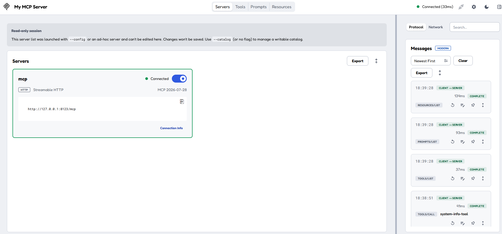
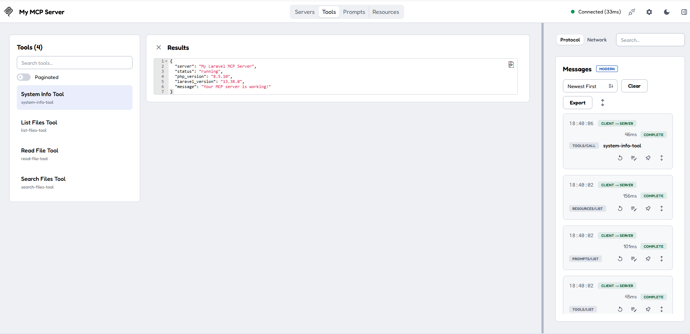
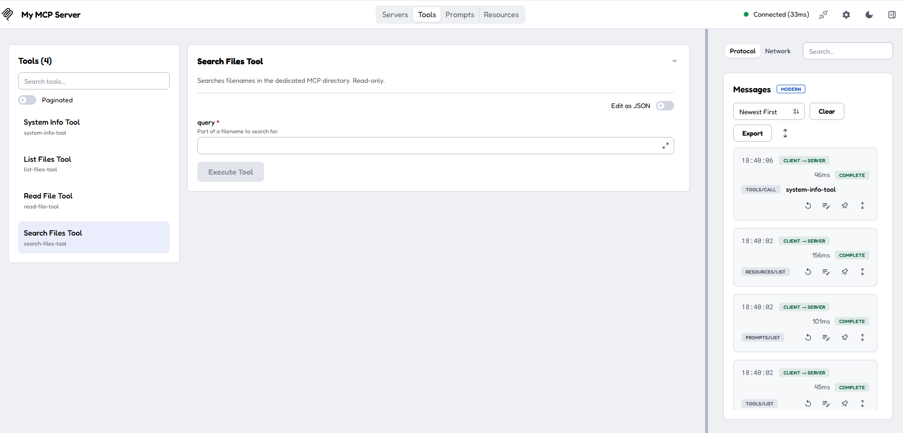
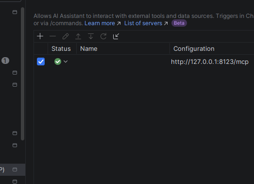
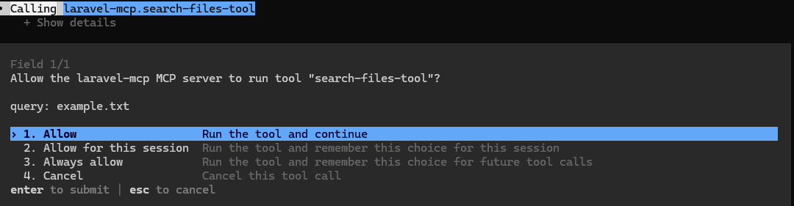

# Screenshots and demo media

## Included: genuine screenshots from local testing

These screenshots were captured on the standalone Laravel MCP project. They show actual tool discovery, connection status and configuration, not a mock-up.

### 1. MCP Inspector connected

The server is connected over Streamable HTTP at `127.0.0.1:8123/mcp`. The **Read-only session** notice refers to the Inspector's temporary client configuration, not to the MCP server's tools.

### 2. Four tools discovered and a successful result

The image shows `System Info Tool`, `List Files Tool`, `Read File Tool`, and `Search Files Tool`, together with a completed System Info call.

### 3. Search Files tool input

This screenshot shows the *input form* for the search tool, not a successful filename search result. Use a separately captured result screenshot if demonstrating an actual search.

### 4. PhpStorm recognizes the MCP server

This shows the MCP connection in the IDE configuration; it does not establish that Junie or other separately licensed AI agents can run.

### 5. Codex asks permission before a tool call

This is an example of a tool-approval prompt, not a completed tool response.

## Screenshots to capture before release

| Suggested file | Screen | What it should prove |
| --- | --- | --- |
| `inspector-read-file.png` | Inspector, `read-file-tool` response | `example.txt` reads successfully |
| `codex-tool-chain.png` | Codex complete response | AI invoked list, search and read tools, showing the tool names |
| `security-traversal-rejected.png` | Inspector error response | Attempt to read `../.env` is denied |
| `powershell-local-server.png` | Terminal | Laravel is serving on `127.0.0.1:8123` |

Use **Windows Snipping Tool** or `Win + Shift + S`. Save as PNG. Crop to the actual tool result; don't include the desktop, browser tabs or unrelated projects. Keep a consistent width and readable text. Use descriptive Markdown alt text.

### Never publish in screenshots

- Inspector URLs containing `MCP_INSPECTOR_API_TOKEN=` or any bearer token
- The contents of `.env`, API keys, passwords, or connection strings
- Email addresses, account names, session identifiers and personal folders if unnecessary
- Customer data or proprietary code from other projects
- JWTs, OAuth callback URLs with codes, Git remote credentials or SSH keys

Replace all potentially sensitive values with harmless local examples **before capturing** where possible. When redaction is unavoidable, obscure with an opaque block, not a transparency or a blur that could be reversed.

### README screenshot layout

The README includes the real connection, tool discovery and search input screens. For the final release, add a **completed Codex tool workflow** screenshot near the top as stronger evidence that an AI client successfully uses the server. Keep detailed security screenshots in this guide.

### Optional short demo

Record a 30–60 second screen capture showing: start server → open Inspector → list tools → run ReadFileTool → ask Codex to read `example.txt`. Do not include live tokens in the recording. Store an appropriately compressed MP4 on a release page or link a hosted demo from the README.
